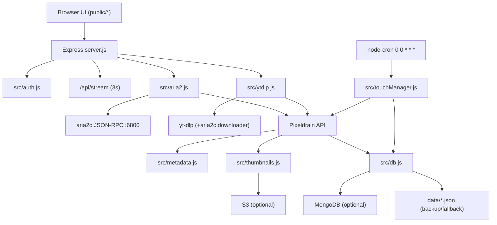

# Codebase Documentation — PixelTouch Manager (`aria2c-pixeldrain`)

> Generated for future AI assistants. Reflects repository as analyzed. Prefer code over this doc if conflicts.

## 1. Project Identity

- Package name: `gotouch-manager` (v1.0.0)
- Product name: PixelTouch Manager / GoTouch Manager
- Purpose: self-hosted Node.js web app for high-speed remote downloading (aria2c or yt-dlp), streaming upload to Pixeldrain, metadata/thumbnail extraction, and daily Pixeldrain retention "touch" pings.
- Entry point: `server.js` (`npm start` / `npm run dev`)
- Default port: `6258`
- Runtime: Node.js CommonJS (`"type": "commonjs"`), no TypeScript, no test/lint scripts.

## 2. Tech Stack

Dependencies (`package.json`):

- express 4, cookie-parser, dotenv
- axios, form-data
- jsonwebtoken
- mongodb 7
- node-cron
- @aws-sdk/client-s3, @aws-sdk/lib-storage

External binaries (optional/required depending feature):

- `aria2c` (download engine)
- `yt-dlp` (download engine)
- `ffmpeg` / `ffprobe` (metadata + 15-frame screenshots)
- `cloudflared` (optional tunnel)

## 3. Directory Structure

```text
aria2c-pixeldrain/
├── server.js                 # Express app, REST API, SSE, startup/shutdown
├── package.json
├── .env / .env.example
├── README.md
├── knowledge.md
├── prd.md
├── public/                   # Static frontend
│   ├── index.html, app.js, style.css
│   ├── watch.html, watch.js
│   └── gallery.html, gallery.js
├── src/
│   ├── aria2.js              # aria2 RPC + serial queue orchestrator
│   ├── auth.js               # PIN/JWT/share secrets/rate limit
│   ├── cloudflared.js        # optional tunnel daemon
│   ├── db.js                 # in-memory cache + JSON/Mongo persistence
│   ├── logger.js
│   ├── metadata.js           # magic bytes, ffprobe, sanitize/remux
│   ├── mongoClient.js
│   ├── pixeldrain.js         # Pixeldrain PUT upload + metadata/thumbs
│   ├── s3Client.js
│   ├── s3Storage.js
│   ├── thumbnails.js         # ffmpeg frame extraction + S3 migration
│   ├── touchManager.js       # retention cron + 12% chunk touch
│   └── ytdlp.js              # yt-dlp spawn/parse/upload
└── data/                     # runtime (gitignored mostly)
    ├── files.json, queue.json, download-log.json
    ├── downloads/
    └── image/
```

## 4. High-Level Architecture



## 5. Core Runtime Behavior

### Startup (`server.js` listen callback)

1. `db.initDbEngine()` loads local JSON then MongoDB if configured.
2. S3 connectivity test; auto-migrates local images if S3 connected.
3. `aria2.startMonitor()` starts 3s polling.
4. `touchManager.initScheduler()` starts daily cron.
5. `cloudflared.startCloudflared()` if enabled.
6. After 1.5s: kill leftover yt-dlp processes, clean orphaned temp files, `aria2.wipeAllAria2Tasks()`, reset stuck queue items (`DOWNLOADING`/`UPLOADING`/`PROCESSING`) to `PAUSED`.

### Shutdown

`SIGINT`/`SIGTERM`/`SIGHUP`: stop cloudflared, kill yt-dlp processes, clean orphaned temp files, exit after 500ms.

### Strict serial pipeline

Only one download/upload/process/cleanup task runs at a time. `aria2.isPipelineBusy()` checks active uploads, yt-dlp tasks, and queue statuses. `processNextQueueItem()` launches next `QUEUED` item only when pipeline clear.

### Queue statuses

`QUEUED`, `DOWNLOADING`, `UPLOADING`, `PROCESSING`, `PAUSED`, `UPLOADED` (transient), plus failed log. In-flight statuses: `DOWNLOADING`, `UPLOADING`, `PROCESSING`.

### aria2 completion handling

`pollCompletedDownloads()` (3s) looks at `aria2.tellStopped`. On `complete`, uploads to Pixeldrain, extracts metadata/thumbs, adds DB record, cleans local file, removes queue item, then `processNextQueueItem()`. On `error`, logs failure, cleans files, removes queue item.

## 6. Module Reference

| File | Responsibility | Key exports |
|---|---|---|
| `server.js` | Express server, all HTTP routes, SSE, startup/shutdown | entry point |
| `src/aria2.js` | aria2 JSON-RPC, daemon auto-start, 16 connections, queue orchestration, cleanup | `checkConnection`, `addDownload`, `removeDownload`, `getDownloadsStatus`, `getUnmatchedQueueTasks`, `pauseAll`, `unpauseAll`, `pauseTask`, `unpauseTask`, `processNextQueueItem`, `startMonitor`, `wipeAllAria2Tasks` |
| `src/ytdlp.js` | yt-dlp spawn, stdout/stderr parsing, upload, cleanup | `getDownloadsStatus`, `startDownload`, `removeDownload`, `killAllActiveYtDlpProcesses`, `cleanUpOrphanedTempFiles`, `activeTasks` |
| `src/pixeldrain.js` | Pixeldrain PUT streaming upload, progress callbacks, metadata/thumbs, DB insert, cleanup | `uploadToPixeldrain` |
| `src/metadata.js` | magic bytes, image/video dims, ffprobe, format helpers, fake PNG header sanitization/remux | `formatBytes`, `formatDuration`, `getCategory`, `extractMetadata`, `sanitizeVideoFile` |
| `src/thumbnails.js` | image thumb copy, 15-frame ffmpeg extraction, S3 upload/cleanup | `IMAGES_DIR`, `generateThumbnails` |
| `src/touchManager.js` | daily cron, 12% chunk touch, status update | `touchFileRecord`, `touchAllFiles`, `initScheduler` |
## 6. Module Reference (continued)

| File | Responsibility | Key exports |
|---|---|---|
| `src/db.js` | in-memory cache, file/queue/download-log repos, Mongo/JSON sync, migration | `initDbEngine`, `refreshFromMongo`, `generateId`, `getAllFiles`, `getAllFilesAsync`, `getFileById`, `addFile`, `updateFile`, `setFileThumbnail`, `deleteFile`, `getAllQueue`, `addToQueue`, `updateQueueItem`, `removeFromQueue`, `clearQueue`, `getAllDownloadLog`, `addToDownloadLog`, `clearDownloadLog`, `migrateJsonToMongo`, `getDbStatus`, constants |
| `src/auth.js` | PIN verify, JWT, share secrets, login rate limit | `verifyPin`, `generateToken`, `verifyToken`, `requireAuth`, `createShareSecret`, `verifyShareSecret`, `allowLoginAttempt`, `resetLoginAttempts` |
| `src/mongoClient.js` | Mongo connection/collections/test | `connectMongo`, `closeMongo`, `getDb`, `getFilesCollection`, `getQueueCollection`, `getDownloadLogCollection`, `isMongoConfigured`, `isMongoConnected`, `getMongoDbName`, `getMongoUriMasked`, `testMongoConnection` |
| `src/s3Client.js` | S3 client singleton/config | `getS3Client`, `isS3Configured`, `getBucket`, `getFolderPrefix` |
| `src/s3Storage.js` | S3 test/upload/stream/delete/migration/status | `uploadImageToS3`, `getImageStreamFromS3`, `deleteImageFromS3`, `deleteFileThumbnailsFromS3`, `syncAllLocalImagesToS3`, `getS3Status`, `testS3Connection`, `formatBytes` |
| `src/cloudflared.js` | tunnel daemon | `startCloudflared`, `stopCloudflared`, `isCloudflaredEnabled`, `getStatus` |
| `src/logger.js` | debug/info/warn/error | `isDebug`, `debug`, `info`, `warn`, `error` |

## 7. HTTP API Surface

All protected routes use `auth.requireAuth` (cookie `gotouch_token` or Bearer token). Public auth routes noted.

### Auth

- `POST /api/login` body `{ pin }` — rate limited 5 attempts/60s per IP
- `GET /api/auth/check`
- `POST /api/logout`

### Realtime

- `GET /api/stream` — SSE, 3s updates: `{ downloads, conn, files, dataSizeFormatted, dataSizeBytes }`

### Downloads / Queue

- `GET /api/downloads` — aria2 + yt-dlp + unmatched queue rows
- `POST /api/downloads` body `{ url, filename, customFilename, engine }`, `engine` `aria2` (default) or `ytdlp`
- `DELETE /api/downloads/:gid`
- `POST /api/queue/pause-all`
- `POST /api/queue/unpause-all`
- `POST /api/queue/:gid/pause`
- `POST /api/queue/:gid/unpause`
- `GET /api/download-log`
- `DELETE /api/download-log`

### Files (ledger)

- `GET /api/files`
- `PATCH /api/files/:id` body subset: `custom_name`, `status`, `download_url`, `category`, `selected_thumbnail`, `tags`, `engine`
- `PATCH /api/files/:id/thumbnail` body `{ thumbnail }`
- `POST /api/files/:id/touch`
- `POST /api/files/touch-all` body/query `force`
- `DELETE /api/files/:id` (also deletes S3 thumbnails)
- `POST /api/files/:id/report-playback-error` body `{ message }`
- `POST /api/files/:id/report-playable`

### S3

- `GET /api/s3/status`
- `POST /api/s3/sync-images`
- `POST /api/s3/test`

### Database

- `GET /api/db/status`
- `POST /api/db/test`
- `POST /api/db/migrate-to-mongo`

### Images

- `GET /data/image/:filename` (protected) — local first, then S3 stream proxy

### Video

- `GET /watch` — page
- `GET /api/video/:id` — auth or share secret; proxies Pixeldrain with range support
- `POST /api/video/:id/share` — creates 1h share secret

### Pages

- `GET /gallery`
- `GET *` SPA fallback to `index.html`

## 8. Data Models

### File record (`data/files.json` / Mongo `files`)

```json
{
  "id": "gt_<timestamp>_<random>",
  "filename": "gt_...mp4",
  "custom_name": "Display title",
  "original_filename": "remote-name.mp4",
  "source_url": "https://...",
  "engine": "aria2|ytdlp",
  "pixeldrain_id": "abc123",
  "download_url": "https://pixeldrain.com/u/abc123",
  "admin_code": "",
  "created_at": "ISO",
  "last_touched": "ISO",
  "status": "LIVE|DEAD",
  "tags": ["tag"],
  "metadata": {
    "size_bytes": 0,
    "size_formatted": "0 B",
    "category": "video|image|audio|archive|document|file",
    "extension": "mp4",
    "source_url": "https://...",
    "resolution": "1920x1080",
    "width": 1920,
    "height": 1080,
    "duration_seconds": 10,
    "duration_formatted": "00:10"
  },
  "thumbnails": ["/data/image/...jpg"],
  "selected_thumbnail": "/data/image/...jpg",
  "playable": true,
  "playable_error": "",
  "playable_checked_at": "ISO",
  "thumbnail_count": 15,
  "thumbnail_size_bytes": 0,
  "thumbnail_size_formatted": "0 B"
}
```

`enrichFile()` adds thumbnail count/size at read time.

### Queue item (`data/queue.json` / Mongo `queue`)

```json
{
  "id": "q_<timestamp>_<random>",
  "gid": "aria2 gid or yt-dlp task id",
  "url": "https://...",
  "custom_name": "...",
  "filename": "...",
  "engine": "aria2|ytdlp",
  "status": "QUEUED|DOWNLOADING|UPLOADING|PROCESSING|PAUSED",
  "created_at": "ISO",
  "error": ""
}
```

### Download log (`data/download-log.json` / Mongo `download-log`)

```json
{
  "id": "dl_...",
  "url": "...",
  "custom_name": "...",
  "filename": "...",
  "engine": "aria2|ytdlp",
  "status": "FAILED",
  "error": "...",
  "created_at": "ISO",
  "failed_at": "ISO"
}
```

Max 200 log entries.

## 9. Persistence

- `DATA_DIR` default `./data`
- Paths: `data/files.json`, `data/queue.json`, `data/download-log.json`, `data/downloads`, `data/image`
- In-memory caches loaded at startup; MongoDB (if `MONGO_URI`/`MONGODB_URI`) becomes source of truth with local JSON backup.
- Mongo collections: `files`, `queue`, `download-log`; indexes on id/status/created_at/gid.
- `refreshFromMongo()` throttled to max once/1000ms unless forced; background revalidation if >3s stale.
- S3 stores thumbnails under `${S3_FOLDER_PREFIX}/` (default `aria2/`); local disk fallback.

## 10. Environment Variables (`.env`)

| Var | Default / notes |
|---|---|
| `PORT` | 6258 |
| `ADMIN_PIN` | 123456 |
| `ARIA2_RPC_URL` | http://127.0.0.1:6800/jsonrpc |
| `ARIA2_RPC_SECRET` | empty |
| `PIXELDRAIN_API_TOKEN` | required for uploads |
| `DEFAULT_STORAGE_PROVIDER` | pixeldrain |
| `DATA_DIR` | ./data |
| `JWT_SECRET` | change in production |
| `TOUCH_INTERVAL_DAYS` | 30 |
| `AUTO_START_ARIA2` | true |
| `ARIA2_PATH` | aria2c |
| `DEBUG` | false |
| `S3_ENDPOINT`, `S3_REGION`, `S3_ACCESS_KEY_ID`, `S3_SECRET_ACCESS_KEY`, `S3_BUCKET`, `S3_FOLDER_PREFIX` | optional S3 |
| `MONGO_URI` / `MONGODB_URI` | optional Mongo |
| `MONGODB_DB_NAME` | gotouch |
| `ENABLE_CLOUDFLARED` | false |
| `CLOUDFLARED_TOKEN`, `CLOUDFLARED_PATH` | optional tunnel |
| `YTDLP_PATH` | optional yt-dlp binary |
## 11. Metadata & Sanitization Details

- `metadata.extractMetadata()` reads first 128KB, detects category/extension via magic bytes, gets size, image dims, video dims/duration via ffprobe then MP4 fallback.
- `metadata.sanitizeVideoFile()` detects fake PNG header, strips 74 bytes in-place, remuxes to faststart MP4 if enough disk space.
- `getFreeDiskSpace()` uses wmic (Windows) or df (Linux).

## 12. Thumbnail Details

- Images: copy file to `data/image/<id>-thumb.jpg`.
- Videos: ffmpeg extracts 15 frames at 640px max; single-pass then sequential fallback.
- If S3 configured, uploads each image and deletes local copy; returns `/data/image/<filename>` URLs (served via proxy).
- `processAndSaveThumbnails()` handles S3 upload.

## 13. Touch / Retention Details

- Cron: `0 0 * * *`.
- Eligibility: status != `DEAD`, and `now - (last_touched || created_at) >= TOUCH_INTERVAL_DAYS` unless forced.
- Touch performs Pixeldrain GET with `Range: bytes=0-<12%>` (min 10% required by Pixeldrain), then destroys stream.
- 200/206 => `LIVE`, update `last_touched`; 404 => `DEAD`; others unchanged.
- Random 1-3s delay between files.

## 14. Frontend

- `public/index.html` + `app.js`: PIN keypad, dashboard, SSE receiver, download submission/batch, queue rendering, ledger, metadata modal, gallery.
- `public/watch.html` + `watch.js`: video player using `/api/video/:id`.
- `public/gallery.html` + `gallery.js`: thumbnail gallery.
- `style.css`: Obsidian Flux glassmorphism theme.
- SSE fallback polling if EventSource errors.

## 15. Conventions / Notes for Future AI

- CommonJS modules; no build step.
- No tests or lint configured; verify manually with `node server.js`.
- Auth is single-user PIN; JWT 7 days; cookie not secure (set true behind HTTPS).
- Pixeldrain token required for uploads; missing token throws.
- Do not assume GoFile; code uses Pixeldrain despite older README mentions GoFile.
- Queue is serial; do not parallelize downloads.
- `aria2.wipeAllAria2Tasks()` wipes entire downloads dir only if RPC reachable.
- Share secrets are in-memory and expire in 1 hour.
- Login attempts map is in-memory (resets on restart).
- Frontend references `gofile_id` fallback in metadata modal; canonical is `pixeldrain_id`.
- `knowledge.md` is a prior, slightly different architecture doc (mentions GoFile); codebase-docs.md is code-aligned.

## 16. Quick Start

```bash
npm install
cp .env.example .env
# edit .env
node server.js
# open http://localhost:6258
```
